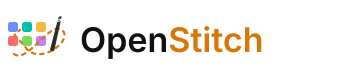
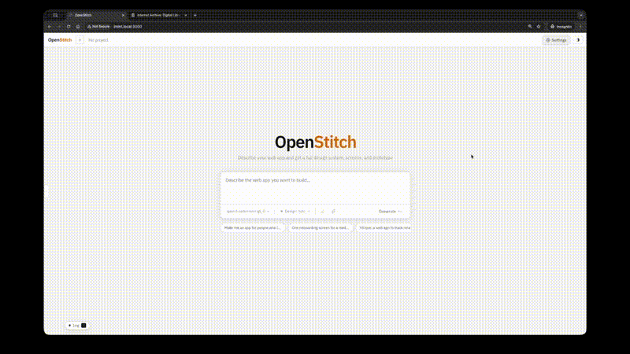
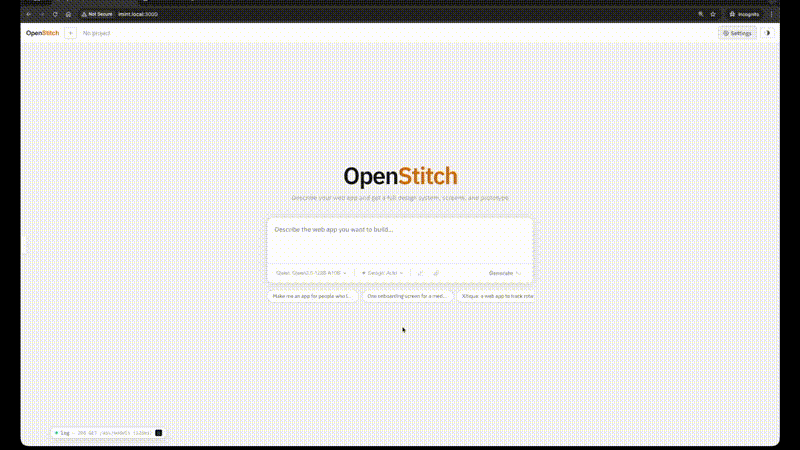
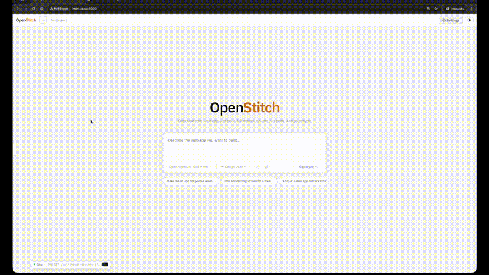

<p align="center">
  
</p>

Open-source, locally-runnable AI UI design tool. Describe a screen, drop a screenshot, or sketch a wireframe - OpenStitch generates rendered, interactive frontend code on an infinite canvas. Link screens into flows and prototype them in-app. No cloud required.

> Inspired by [Google Stitch](https://stitch.withgoogle.com), [screenshot-to-code](https://github.com/abi/screenshot-to-code), and [draw-a-ui](https://github.com/sawyerhood/draw-a-ui).

---

<table>
  <tr>
    <td align="center"><b>Generate App</b></td>
    <td align="center"><b>Screenshot → UI</b></td>
    <td align="center"><b>Sketch → UI</b></td>
  </tr>
  <tr>
    <td></td>
    <td></td>
    <td></td>
  </tr>
  <tr>
    <td align="center"><a href="https://www.youtube.com/watch?v=5jdm2byYw1g">Watch on YouTube</a></td>
    <td align="center"><a href="https://www.youtube.com/watch?v=PNKGt_W7kRk">Watch on YouTube</a></td>
    <td align="center"><a href="https://www.youtube.com/watch?v=KFKkkQYgoqo">Watch on YouTube</a></td>
  </tr>
</table>

---

## Features

- **Text → UI** - describe any screen in natural language, get working HTML, React, or Vue code instantly
- **Screenshot → UI** - drop a screenshot, generate a code replica with a vision model
- **Sketch → UI** - draw a rough wireframe, feed it to a vision model, get real code
- **Generate** - describe a full product, pick a design system (or let AI generate one), get multiple screens in one shot with a shared DESIGN.md
- **Replicate** - attach a screenshot or wireframe sketch, get a faithful code replica using a vision model
- **Iterate** - refine any screen with follow-up prompts
- **Design systems** - pick from 50+ brand design systems (Linear, Stripe, Vercel, ElevenLabs, etc.) or let AI generate one from your description
- **Infinite canvas** - arrange screens spatially, draw flow edges between them to wire navigation
- **Play Mode** - run your prototype full-screen with real click navigation between linked screens
- **Workspace panel** - view DESIGN.md, plan, and screen code side by side with live preview
- **Skills** - apply functional patterns (responsive, a11y, animations, layout templates) to guide generation
- **Export** - download all screens as a ZIP with DESIGN.md + per-screen HTML

---

## Quick Start

Requirements: [Docker + Docker Compose](https://docs.docker.com/get-docker/), [Ollama](https://ollama.com) running locally.

```bash
git clone https://github.com/iohelder/openstitch
cd openstitch

cp .env.example .env        # add cloud API keys if you want (optional)

make pull-models            # pulls qwen3-coder:30b, qwen2.5-coder:7b, qwen2.5vl:7b
make up                     # starts frontend + backend

open http://localhost:3000
```

| Port | What |
|---|---|
| 3000 | App (Nginx serves React frontend, proxies API + WebSocket) |
| 7001 | Backend API (direct access, useful for debugging) |
| `./data/openstitch.db` | SQLite database, persisted via Docker volume |

Once the app loads, **create a project first** (top-left sidebar). The canvas and generation interface only become active after a project exists.

> **Security note:** OpenStitch is intended for local/private network use only. It has no authentication. Do not expose port 3000 or 7001 to the public internet.

---

## Models

### Text (code generation)

| Model | Size | Notes |
|---|---|---|
| qwen3-coder:30b | 19 GB | ✅ tested, best quality, fast |
| qwen3-coder-next:80B | 52 GB | ✅ tested, best quality, slower |

Smaller models (e.g. qwen2.5-coder:7b) may work but have not been tested.

### Vision (screenshot / sketch input)

| Model | Size | Notes |
|---|---|---|
| Qwen3.5-122B-A10B | 80 GB | ✅ tested, best results via Ollama or OpenRouter |

Smaller vision models (qwen2.5vl:32b, qwen2.5vl:7b) may work but have not been tested. A strong vision model makes a big difference for screenshot/sketch → UI quality.

### Cloud (optional)

Only **OpenRouter** has been tested. Other providers (OpenAI, Anthropic, Gemini) are wired up but untested. If you have OpenRouter, that covers all of them anyway.

Add keys to `.env` and they load into Settings on first startup. You can also set or update them through Settings in the app at any time. Cloud models are used on-demand, not by default.

```
OPENAI_API_KEY=sk-...
ANTHROPIC_API_KEY=sk-ant-...
GEMINI_API_KEY=AIza...
OPENROUTER_API_KEY=sk-or-...
```

> Keys set via the Settings UI are stored in the database and take priority over `.env` values.

---

## Keyboard Shortcuts

| Action | Key |
|---|---|
| Focus prompt | G |
| Generate / send | Cmd/Ctrl + Enter |
| Toggle Play Mode | P |
| Undo | Cmd/Ctrl + Z |
| Redo | Cmd/Ctrl + Shift + Z |
| Exit Play Mode / close | Esc |

---

## Architecture

```
Frontend:  React 18 + Vite + TypeScript + Tailwind
Canvas:    @xyflow/react (React Flow)
Editor:    CodeMirror 6
State:     Zustand
Backend:   FastAPI (Python 3.11+)
Database:  SQLite via aiosqlite
AI:        Ollama (local) · OpenRouter
```

---

## Development

```bash
make dev-backend     # uvicorn with --reload on port 7001
make dev-frontend    # Vite dev server on port 3000
make typecheck       # pnpm typecheck + mypy
make lint            # ruff + eslint
```

---

## Navigation Triggers

When drawing a flow edge between screens, the trigger field controls which click fires the navigation. Selectors are matched against the clicked element and its ancestors up to the nearest button or link.

| Trigger | Matches |
|---|---|
| `#submit-btn` | Element with `id="submit-btn"` |
| `.btn-primary` | Any element with class `btn-primary` |
| `button.btn-primary` | `<button>` with class `btn-primary` |
| `button.hover:text-slate-700` | Works - Tailwind colon-variant classes treated as plain class names |
| `:contains("Sign in")` | Any clickable whose text includes "Sign in" (case-insensitive) |
| `button:contains("Go")` | `<button>` whose text includes "Go" |
| `button:first-of-type` | First `<button>` among its siblings |
| `button:nth-of-type(2)` | Second `<button>` among its siblings |
| `:nth-child(1)` | First child of its parent |
| `[data-nav="home"]` | Element with `data-nav="home"` attribute |
| `[data-action^="nav"]` | Attribute value starts with "nav" |
| `[data-action*="save"]` | Attribute value contains "save" |

**Tips:**

- Partial class match (e.g. `.btn`) triggers on any element sharing that class - useful when you just want to test transitions and don't need to distinguish between buttons.
- For identical buttons on the same screen, the most reliable options are:
  1. Give each a unique `id` and use `#id` as the trigger
  2. Use `:contains("label text")` if their text differs
  3. Use `:nth-of-type(n)` if they're siblings
- Selectors are matched against the full click path (child - parent chain), so `.icon` inside `button.nav-btn` can be matched by either selector.
- Descendant combinators (space-separated) are not supported - match on a single element only.

---

## Roadmap

- **Live color palette editor**: tweak DESIGN.md color tokens and see all screens update instantly without re-generating (CSS variable hot-swap, no LLM call needed)
- **Edit DESIGN.md → regenerate all screens**: modify the design system, trigger a full re-generation pass so every screen reflects the new design
- **Design panel**: sidebar view of the active DESIGN.md with rendered color swatches and typography samples
- **Re-generate with different design**: swap the design system on an existing project and regenerate all screens
- **Auto-link navigation**: detect nav links across screens and wire flow edges automatically
- **Test cloud providers**: verify OpenAI, Anthropic, and Gemini API keys end-to-end (not needed if you use OpenRouter, which covers all of them)
- **llama.cpp endpoint support**: connect to a local llama.cpp server as an alternative to Ollama (Ollama is still preferred since it can list available models automatically)

---

## Limitations

- **Play Mode** - click navigation is simulated; no real router code is generated
- **iframe sandbox** - some browser APIs won't work in preview (geolocation, notifications, clipboard, etc.)
- **No multi-user** - single user, no collaboration
- **SQLite** - fine for local use, not designed for concurrent access

---

## Shoutout

- [screenshot-to-code](https://github.com/abi/screenshot-to-code) - screenshot and design-to-code via vision models
- [draw-a-ui](https://github.com/sawyerhood/draw-a-ui) - sketch a wireframe, get UI code
- [awesome-design-md](https://github.com/VoltAgent/awesome-design-md) - curated list of design system prompts and resources

---

## License

MIT. See `LICENSE`.
